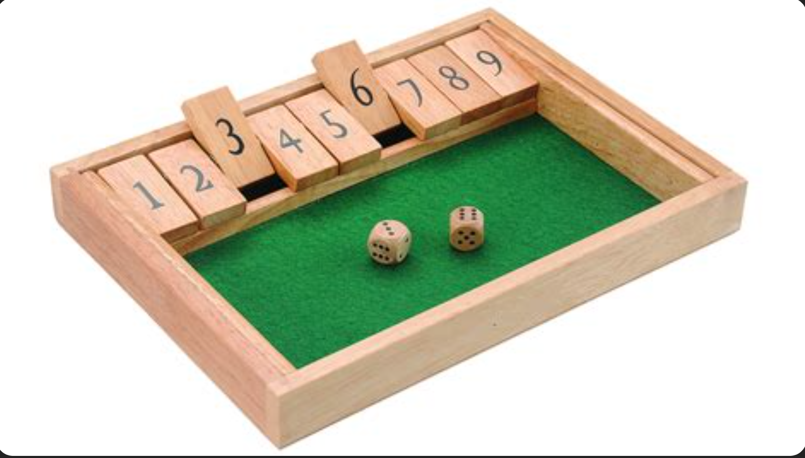

# Shut the box

## Game overview

Shut the Box is a classic pub game where players roll a pair of dice and lower tiles on the game tray that correspond with the numbers they roll. The goal of the game is to lower as many tiles as possible on a single turn before running out of options. Any tiles left upright at the end of a player’s turn are added to their score. The player with the lowest score wins![2]

Shut the Box is usually played with 2-4 players, but you can also play solo. Just compete against your lowest score. [3]

## Game board

The game board has a rectangular area to roll two dice

Above the board are nine tiles numbered from one to nine. These start up (displayed), but are moved down during gameplay to a non-displayed state.

## Game play

On a player’s turn, they throw the dice into the game tray and add up the total of their roll. They then lower 1 or more tiles that equal the total they rolled. For example, if a player rolled a 4 and a 3, their total is 7. Therefore, they could choose to lower one of the following tile combinations:

- 7
- 4 & 3
- 5 & 2
- 6 & 1
- 4, 2, & 1

After lowering the tile(s), the player continues to roll the dice and lower tiles until they reach the point where no tiles correspond with the total they roll. For example, if the total of a player’s roll is 6 and only the 7 and 2 tiles remain upright, they’re unable to lower any tiles and their turn is over. 

Once a player’s turn is over, the next player starts their turn with all of the tiles in the upright position. [4] This continues until each player has taken one turn.

If a player manages to lower all of the tiles on their turn, they “shut the box” and automatically win the game!

Once the 7 and higher tiles have all been lowered, players may choose to roll with 1 die instead of 2.

## Scoring

Players add the total of any upright tiles at the end of their turn to their score. The player with the lowest score wins![5]
For example, if a player ends their turn with the 1, 2, and 7 tiles upright, their final score is 10.

